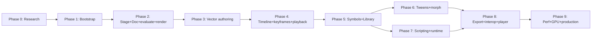

# 09 — Implementation Roadmap (Planning Only)

> **Status: PLAN — not to be executed.** This roadmap is for planning only. **No phase is to be
> started without explicit user authorization** (see `AGENTS.md` §7–8 and doc 10 §7). Each
> milestone has **measurable completion criteria**. Dependencies are noted; a few adjustments to
> the given outline are recommended (§3).

## 0. Phase 0 — Research and architectural planning (this work)

**Status: COMPLETE** (this document set).
- Deliverables: `research/00`–`10`, `AGENTS.md`.
- Completion criteria: all documents written; findings distinguished from recommendations;
  decisions requiring approval listed (doc 10 §7); no code written; no repo modified. ✔

## 1. Phase 1 — Application bootstrap and Craft integration

Goal: an empty FlashCraft app that launches a dark Craft-style window, is wired to the shared
infrastructure, and passes the suite quality gates.

| # | Milestone | Measurable completion criteria |
|---|-----------|-------------------------------|
| 1.1 | Cargo workspace + `xtask` | `cargo xtask layers` and `cargo xtask wasm` exist and pass on the empty workspace; `[workspace.dependencies]` pins `craft-ui`, `craft-settings`, `craft-atomic`, `craft-quit`, `swf` (Ruffle), `effectcraft-time`, `effectcraft-keyframe`, `kurbo`, `peniko`, `vello_cpu`, `boa_engine`; `[lints]` deny no-panic/no-unsafe. |
| 1.2 | `apps/flashcraft` shell | Launches an eframe window with a dark `theme.rs` (doc 06 palette) via `craft-ui` + `craft-quit`; a "FlashCraft" title bar; `cargo run` works on macOS/Windows/Linux. |
| 1.3 | `flashcraft-engine` skeleton | A `Session` with an (empty) `CommandSpec` registry, `Session::execute`, `Arc<Document>` undo, and a `guard`; a "New Document" command; the JSON control channel (`--control <port>`) and `ui.screenshot` work. |
| 1.4 | `apps/flashcraft-cli` | `flashcraft-cli run` (headless) and `flashcraft-cli commands` list the registry; `--bridge` targets the running app. |
| 1.5 | `flashcraft-mcp` | `flashcraft-cli mcp` (stdio) exposes the command registry as tools; a smoke test drives one command. |
| 1.6 | Quality gates | `cargo fmt --check`, `cargo clippy --workspace --all-targets -- -D warnings`, `cargo test --workspace`, `cargo xtask layers`, `cargo xtask wasm` all green. |

**Depends on:** Phase 0 decisions (native format, reuse scope, scripting engine) being approved —
at minimum the reuse pins (1.1) require the "reuse scope" decision.

## 2. Phase 2 — Stage, viewport, and document foundation

Goal: a document with stage settings, a renderable stage/viewport, and save/load of the native
format.

| # | Milestone | Measurable completion criteria |
|---|-----------|-------------------------------|
| 2.1 | `flashcraft-geom`/`color`/`time` | L0 crates compile; twips↔px and 16.8-fixed matrix conversions unit-tested; `time` reuses `effectcraft-time` (a `FrameRate` + `Tick` round-trip test). |
| 2.2 | `flashcraft-doc` core | `Document`/`DocSettings`/`Scene`/`Timeline`/`Layer`/`Frame`/`Placed`/`Library` types (doc 08 §3.1) with serde + `Arc` sharing + `Document::check()` invariants (property tests). |
| 2.3 | `flashcraft-timeline::evaluate` (static) | For a document with static frames (no tweens, no symbols), `evaluate(doc, t)` returns the correct display list for every frame, including frame spans (holds) — golden tests. |
| 2.4 | `flashcraft-render` (CPU) | `DisplayList → Pixmap` via `vello_cpu`: renders solid fills, strokes, and a placed bitmap to a golden image; culls by viewport; a (symbol,frame)/(layer,frame) cache is present and hit-tested. |
| 2.5 | Stage viewport (ui-egui) | The stage shows the document at a zoom/pan view transform; pasteboard is dimmed; the stage rectangle is the output bounds; zoom/pan (Hand/Zoom) work; "Clip to stage" toggles the cull. |
| 2.6 | `.flashcraft` native format | Save/Save As/Load of a versioned, compressed, structurally-shared JSON document; atomic save via `craft-atomic`; opens a v1 file; round-trip test (save→load→equal). |
| 2.7 | Document settings UI | Stage size, frame rate, and background color editable (Properties ▸ Document / Modify ▸ Document) and drive the viewport + `evaluate`. |

**Depends on:** Phase 1. **Decision gate:** the native-format decision (doc 10 §7, D1) must be
approved before 2.2/2.6.

## 3. Phase 3 — Vector authoring and editing

Goal: draw and edit vector art on the stage with the Flash tool set.

| # | Milestone | Measurable completion criteria |
|---|-----------|-------------------------------|
| 3.1 | `flashcraft-shapes` | `Shape` (fills/strokes/edges, the SWF-compatible edge/fill model) + FillStyle/LineStyle (doc 08 §3.2); kurbo-backed; golden raster of each fill/stroke style. |
| 3.2 | Drawing tools | Pen, Line, Rectangle, Oval, Polygon/Star tools emit `Action`s that create shapes on the current frame; live preview (Begin/Preview/Commit); unit tests via the control channel (no UI). |
| 3.3 | Selection & transform | Selection/Subselection tools (Flash's 4 sub-selection modes), Free Transform (move/rotate/scale/skew/reflect) as one undo step; hit-testing against the current frame's display list. |
| 3.4 | Paint tools | Paint Bucket (fill), Ink Bottle (stroke), Eyedropper, Eraser; fill/stroke "paint proxy" in the Tools panel; Merge vs Object drawing mode. |
| 3.5 | Grouping / shapes ops | Group/ Ungroup; boolean ops (union/subtract/intersect) on selected shapes; corner-radius on rect/oval live shapes. |
| 3.6 | Text tool | Point + area text (skrifa/harfrust), editable, static vs outlined; font selection from `craft-fonts`; golden render of a styled text frame. |
| 3.7 | Properties panel | The Tool/Object/Frame/Document inspector edits the current selection/frame/document via commands; numeric transform (x/y/w/h/rotation/scale), color/alpha, blend mode. |

**Depends on:** Phase 2. **Decision gate:** boolean-ops backend (doc 10 §7, D8).

## 4. Phase 4 — Timeline and keyframe animation

Goal: a working Flash timeline with frames, keyframes, and the playhead; playback.

| # | Milestone | Measurable completion criteria |
|---|-----------|-------------------------------|
| 4.1 | Timeline panel | Layer headers (name, color, eye/lock/outline, layer-type glyph), frame ruler, frame cells (key ●, blank ○, span ▬), playhead, transport (play/pause/stop/step), frame-number + fps readout; virtualized rows. |
| 4.2 | Frame commands | Add Frame / Add Keyframe / Add Blank Keyframe / Delete / Copy Frames; edit a frame's content at the playhead; each is a command (undoable). |
| 4.3 | Layer commands | Add/Rename/Reorder/Delete layer; layer types (Normal/Folder/Mask/Masked); guide; visibility/lock. |
| 4.4 | Scene commands | Add/Rename/Delete scene; switch active scene. |
| 4.5 | Playback | The playhead advances at the doc frame rate; the stage re-renders via `evaluate`+`render` per frame (frame-worker pool); scrubbing the playhead; loop; step by frame; Home/End. |
| 4.6 | Onion skinning | Onion-skin ghosts (previous/next, configurable count) rendered at low alpha under the current frame. |
| 4.7 | Determinism + cache | Determinism test (same doc+t → identical pixels); the (symbol,frame)/(layer,frame) render cache measurably reuses across scrub positions. |

**Depends on:** Phase 3.

## 5. Phase 5 — Symbols, instances, and asset library

Goal: Flash symbols (graphic/movie clip/button) and the Library; nesting.

| # | Milestone | Measurable completion criteria |
|---|-----------|-------------------------------|
| 5.1 | `SymbolDef` model | Graphic/MovieClip/Button + Bitmap/Sound/Font/Shape/Video definitions in the `Library`; "Convert to Symbol" (selection → definition) command. |
| 5.2 | Instances | Place a `SymbolInstance` (drag from Library or Convert); independent `matrix`/`color`/`name`/`blend`/`filters`; editing the definition updates all instances (shared), instance props stay independent — golden + unit tests. |
| 5.3 | `evaluate` recursion | `evaluate` resolves instances by recursing into the definition's timeline (Graphic follows parent time; MovieClip its own time + loop/first_frame); nested instances (clip-in-clip) render correctly — golden tests. |
| 5.4 | Buttons | Button symbol with Up/Over/Down/Hit frames; hit-region; the runtime hit-tests button states (doc 05). |
| 5.5 | Library panel | The Library (folders, symbol type glyphs, thumbnails, use-count, search, Add to Stage, Convert to Symbol, Export); Movie Explorer tree (scenes→layers→instances→nested). |
| 5.6 | Media import | Import bitmap (PNG/JPEG/WebP) and sound (WAV/MP3) into the Library; embed in `.flashcraft`; place on stage. |

**Depends on:** Phase 4.

## 6. Phase 6 — Tweening and advanced animation tools

Goal: motion and shape tweens, easing, and the graph editor.

| # | Milestone | Measurable completion criteria |
|---|-----------|-------------------------------|
| 6.1 | Motion tween | Create a motion tween between two instance keyframes; `evaluate` interpolates `matrix`/`color`/`filters` via `flashcraft-keyframe`; the timeline shows a colored tween span; scrubbing animates. |
| 6.2 | Easing | Apply CreateJS easing (quad…bounce × In/Out/InOut) per target (position/rotation/scale/color/filters) and a custom piecewise curve; golden frame-matches against the CreateJS functions. |
| 6.3 | Shape tween (morph) | Create a shape tween between two `Shape` forms; the **morph algorithm** (edge/fill matching + ratio) interpolates; golden renders at ratios 0/0.25/0.5/0.75/1; round-trips through SWF `DefineMorphShape` read. |
| 6.4 | Keyframe editing in timeline | Drag a keyframe (retime), drag a tween endpoint, extend a span, split/tween a range — each one undo step. |
| 6.5 | Graph editor (optional) | A panel to edit keyframe easing curves; editing updates `evaluate`. |

**Depends on:** Phase 5. **Risk:** the morph algorithm is the hardest new work (doc 10).

## 7. Phase 7 — Scripting and interactive runtime

Goal: the interactive runtime and the Actions panel (JS via boa).

| # | Milestone | Measurable completion criteria |
|---|-----------|-------------------------------|
| 7.1 | `flashcraft-script` runtime | boa context + `prelude.js` Flash object model (Stage/MovieClip/Sprite/DisplayObject/Timeline/Library/Button/Text) + `__query`/`__exec` bridge; the frame loop (enterFrame→construct→frameScripts→exitFrame) drives events. |
| 7.2 | Authoring-time scripts | The Actions panel (F9) runs JS that edits the document via commands (undoable, journaled); `beginUndoGroup`/`endUndoGroup`; a "run in editor" entry point. |
| 7.3 | Playback-time scripts | Button events (click/over/down), `enterFrame`, `gotoAndPlay/Stop`, `play/pause`, movie-clip scopes; runtime state (playhead, per-clip frame, button hover) lives outside the document. |
| 7.4 | Sandbox | Fresh context per run; `File` reads confined to the document folder; writes/network behind a Preferences toggle; a stack-limit run gets a fresh context + one retry; no clock/random leak. |
| 7.5 | Script Console + MCP/CLI | A Script Console (persistent context); `flashcraft-cli script`; MCP `run_script`; the `script.run` command. |
| 7.6 | Test harness | A headless playback test: load a scripted document, run N frames, assert object-model values and event order. |

**Depends on:** Phase 5 (symbols) and the scripting-engine decision (doc 10 §7, D3).

## 8. Phase 8 — Export, playback, and interoperability

Goal: publish to the open formats and play back.

| # | Milestone | Measurable completion criteria |
|---|-----------|-------------------------------|
| 8.1 | `flashcraft-swf` export | "Publish" writes a SWF (documented tag set, version ≤ 19) from the document; Ruffle plays it and the frames match `evaluate`+`render` (frame-compare) for the test corpus. |
| 8.2 | `flashcraft-swf` import | Import a SWF (any version `swf` supports) into a `Document` (characters → symbols, display-list tags → scenes/layers/frames/instances); fuzzed; round-trips a simple movie. |
| 8.3 | `flashcraft-xfl` | XFL import and export (round-trip `.flashcraft`→XFL→`.flashcraft` preserves the model); conforms to the public XSD on the test corpus. |
| 8.4 | Image/animated export | Export a frame as SVG; export as PNG sequence / GIF / APNG (deterministic). |
| 8.5 | Video export | Export as MP4 (H.264/HEVC/AV1) / WebM (VP9/AV1) / ProRes MOV / image sequences via FilmCraft codecs; reproducible bytes; audio mixdown where present. |
| 8.6 | Sprite sheets | Export a PNG/WEBP atlas + JSON manifest (frame rects, timing). |
| 8.7 | Lottie (bonus) | Export a motion-tween vector animation subset to Lottie (EffectCraft pattern). |
| 8.8 | Standalone player | `flashcraft-cli play` (headless, cpal audio) and a WASM/JS web player (wasm32 build). |
| 8.9 | Optional: PDF print | Stage→PDF via `craft-print`. |

**Depends on:** Phases 6/7. **Decision gate:** SWF/XFL interop scope (doc 10 §7, D4).

## 9. Phase 9 — Performance, refinement, and production readiness

Goal: ship-quality.

| # | Milestone | Measurable completion criteria |
|---|-----------|-------------------------------|
| 9.1 | GPU compositor (if approved) | `flashcraft-gpu` (wgpu) implements the render steps; **CPU/GPU parity** ≤ 1/255 at 8 bpc; `backend = Cpu|Gpu|Auto`; GPU-on for the viewer, CPU for headless/CI. |
| 9.2 | Performance budgets | A `flashcraft-cli perf`/`bench` on a synthetic large document (many symbols/layers/frames) meets render/pan/zoom/hit-test/save-open budgets (sibling-style); report warns on noisy load. |
| 9.3 | Memory/undo | Undo/redo of a large edit is constant-time (snapshot swap); a large-document memory test (dhat, opt-in) within budget. |
| 9.4 | Robustness | All importers fuzzed; the `guard` rolls back on injected panics; autosave/recovery verified (kill the process mid-edit, reopen, recover). |
| 9.5 | Packaging | Installers (macOS .app/.dmg, Windows, Linux), code-signing config, `packaging/` (sibling pattern); web build under a size gate. |
| 9.6 | Docs/parity | `ROADMAP.md`, `docs/architecture.md`, parity/gaps documents; README Status; i18n baseline; accessibility (AccessKit) pass. |
| 9.7 | Release | A tagged release; reproducible build; the full gate suite green on all three OSes + wasm. |

**Depends on:** Phases 1–8. **Decision gate:** GPU investment (doc 10 §7, D5).

## 10. Recommended adjustments to the given outline

1. **Split Phase 8 (interop) from the "player" (8.8).** SWF/XFL interop (8.1–8.3) is the highest-
   value, most testable piece and should land as early as the model stabilizes (it can even
   prototype in Phase 5/6 using the `swf` crate to validate `evaluate` against Ruffle). The
   standalone player (8.8) is lower risk and can follow.
2. **Bring `evaluate` + a CPU render forward (Phase 2).** The deterministic evaluator is the
   keystone; getting a static render working early (Phase 2) de-risks everything downstream and
   gives an early, testable "does a frame look right" loop.
3. **Make the morph algorithm (6.3) a tracked risk with a fallback.** If a robust general morph is
   not achievable early, ship motion tweens first (6.1–6.2) and gate shape tweens behind a
   "matched-vertex" fast path (documented limitation), improving the matcher later. This avoids a
   single hard algorithm blocking the whole tweening phase.
4. **Keep audio out of the critical path.** Event sounds/streaming audio and audio export can be a
   sub-milestone of Phase 8 (reusing FilmCraft codecs/cpal) rather than a gating dependency for
   animation.
5. **Phase 7 (scripting) can partially overlap Phase 5/6** (the runtime object model depends on
   symbols, not on tweens), but the Actions panel's authoring-time editing is most useful after
   the timeline (Phase 4) exists. Sequence the *runtime* after Phase 5; the *authoring-time*
   script console can land with Phase 4.
6. **Defer the GPU (9.1) and 3D/particles entirely** — 3D/particles are out of FlashCraft scope
   (doc 08 §7).

## 11. Dependency graph (phases)

**Critical path:** Phase 2 (`evaluate` + render) → Phase 4 (timeline) → Phase 5 (symbols) →
Phase 6 (tweens) → Phase 8 (SWF/XFL interop). Scripting (Phase 7) runs in parallel after symbols.

## 12. Approval gates (no phase starts without)

- **Before Phase 1:** the reuse-scope decision (Ruffle `swf` + `effectcraft-time`/`keyframe`
  pins) and the native-format decision (doc 10 §7).
- **Before Phase 3:** boolean-ops backend (doc 10 §7, D8).
- **Before Phase 6:** the morph-algorithm approach/fallback (doc 10 §7, D9; risk R1 in doc 10 §1).
- **Before Phase 7:** the scripting-engine decision (boa) — doc 10 §7, D3.
- **Before Phase 8:** the SWF/XFL interop scope — doc 10 §7, D4.
- **Before Phase 9:** the GPU investment decision — doc 10 §7, D5.

**Reiterate: this roadmap is a plan. Nothing is to be executed until the user explicitly
authorizes the corresponding phase.**